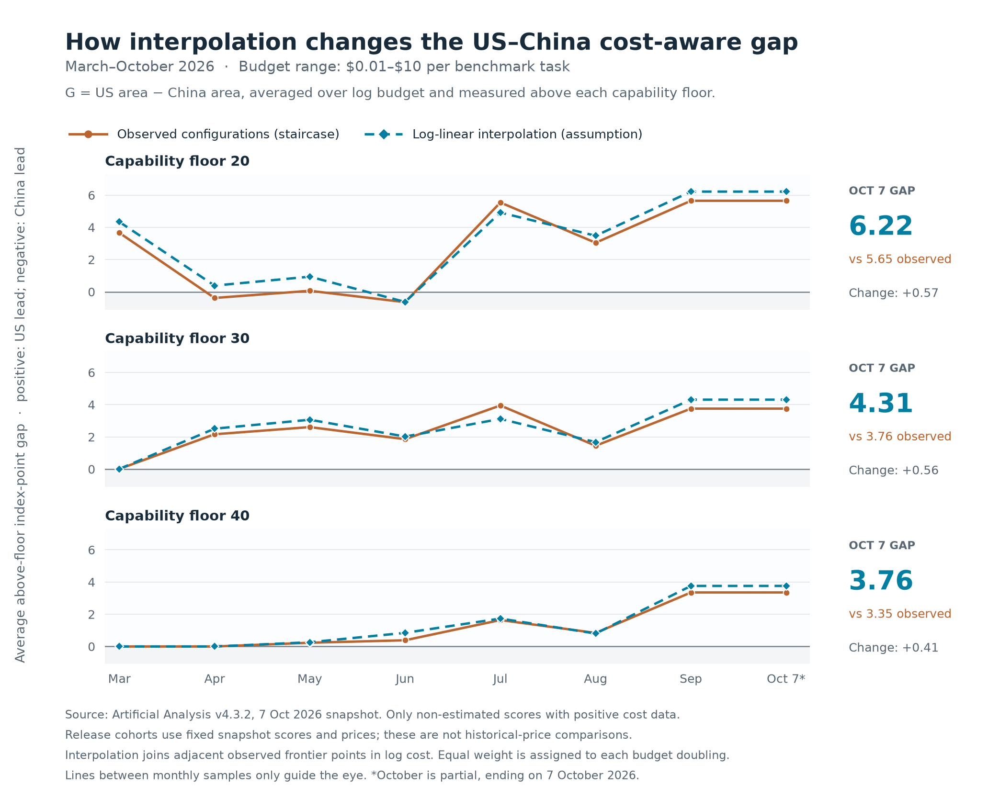

# Pareto Gap

A small, reproducible comparison of US and Chinese public AI models across **capability and cost**, using observations from [Artificial Analysis](https://artificialanalysis.ai/models/).

The question: how does the comparison change when we value the capability available across a range of budgets, rather than only the highest benchmark score? The goal is a transparent method, with assumptions readers can inspect and change.

**Frozen snapshot: 7 October 2026, Intelligence Index v4.3.2.** This repository does not claim to show the latest models. Historical charts apply this one snapshot's scores and prices to cumulative release cohorts; they do **not** reconstruct historical prices or API availability.



## How it works

1. For each country and cutoff date, keep released model configurations with measured intelligence and a positive published benchmark task cost.
2. Build the cost–capability Pareto frontier: configurations that improve on the capability available at a lower cost.
3. Compare the area above a chosen capability floor, with equal weight for every budget doubling.
4. Compare China's area with earlier US cohorts to obtain a monthly bracket and an actual release-date crossing.

Two representations make the assumption visible:

- **Observed staircase:** only measured configurations are affordable options.
- **Log-linear interpolation:** join adjacent frontier points with straight lines in log cost and raw intelligence. The connecting lines represent hypothetical intermediate operating points, not measured model offerings.

The signed gap is `G = US area − China area`. Positive values favor the US; negative values favor China. Units are average above-floor Intelligence Index points, not percentages. A single area ordering does not imply dominance across every budget.

## Example: March–October 2026

Budget: **$0.01–$10 per Intelligence Index task**. Capability floor: **30**. Each cohort ends at month-end, except October, which ends on October 7.

| Chinese cohort | Observed G | Interpolated G | US monthly bracket for interpolated area | Lag in calendar-month bins | First US release crossing |
|---|---:|---:|---|---:|---|
| March | 0.011599 | 0.012058 | No above-floor Chinese coverage | — | — |
| April | 2.163337 | 2.510939 | March–April | 0–1 | April 23 |
| May | 2.608917 | 3.065358 | March–April | 1–2 | April 23 |
| June | 1.858071 | 2.020963 | March–April | 2–3 | April 23 |
| July | 3.950299 | 3.117499 | June–July | 0–1 | July 9 |
| August | 1.453443 | 1.676552 | June–July | 1–2 | July 9 |
| September | 3.755047 | 4.311289 | August–September | 0–1 | September 22 |
| October 7 | 3.755047 | 4.311289 | August–September | 1–2 | September 22 |

For October 7, September 22 is **15 elapsed days earlier**. The “1–2” result is a bracket between calendar-month labels, not a claim of 30–60 elapsed days. September and October have identical areas here; only the cutoff date advances. March's near-zero gap reflects floor clipping and does not establish capability parity.

Interpolation can widen or narrow the gap. It can also lower an estimated area when a new observation bends an earlier connecting line downward. The code checks for multiple crossings rather than assuming the interpolated history always rises. See [the full method and limitations](docs/methodology.md), [snapshot summary](reports/snapshot-summary.md) and [aggregate results](reports/monthly-comparison.json).

## Reproduce

Run from the repository root with Python 3.11+. The calculations and tests use only the standard library. This example uses fictional observations, not the Artificial Analysis snapshot:

```sh
python -m unittest discover -s scripts -p "test_analyze*.py"
python scripts/run_example.py
```

Optional: regenerate the PNG and SVG chart with Matplotlib:

```sh
python -m pip install -r requirements-plot.txt
python scripts/plot_slopes.py --input reports/monthly-comparison.json
```

The real source observations are **not distributed** in this repository. To calculate frontiers from data you are authorized to use, follow the [input schema and import instructions](docs/data.md). Both analysis scripts accept `--input` and `--output`; the interpolation analysis also accepts `--summary`. The scripts preserve this project's fixed snapshot date and measurement basis, so substituting a new dataset requires reviewing those assumptions too.

## Data and scope

- Country follows Artificial Analysis's **model-creator country metadata**, not the location of an API host or a manual classification of labs.
- Measured lower reasoning efforts and non-reasoning variants are included when the necessary score and cost exist. Configurations remain separate observations.
- The primary analysis excludes estimated scores and missing or nonpositive task costs. Missing values are not imputed. The locally analyzed snapshot contained 691 configurations; 113 US and 48 Chinese configurations qualified for the primary cost-aware sample.
- Cost is the weighted average cost per Intelligence Index evaluation task, including actual token consumption. It is neither a token-price quote nor a fixed fee for every real-world task.
- Release cohorts retain deprecated records. Historical withdrawal dates and catalog coverage are unavailable.
- The analysis concerns public benchmark observations. It does not estimate private frontier models, training costs, profitability, robotics capability, or a country's overall AI capacity.

The calculations cover floors `0 / 20 / 30 / 40`, budget windows `$0.01–$10 / $0.01–$1 / $0.10–$10`, and measured-only versus estimated-inclusive score policies. The floor and budget are declared relevance choices, not universal constants.

## Files

| Path | Purpose |
|---|---|
| `examples/models-synthetic.json` | Fictional observations for the runnable example |
| `scripts/run_example.py` | Run both analyses on the fictional dataset |
| `scripts/analyze_frontiers.py` | Observed frontier areas and historical comparisons |
| `scripts/analyze_slopes.py` | Interpolated areas, crossings and decline audits |
| `reports/monthly-comparison.json` | Derived aggregate results, without model-level observations |
| `reports/snapshot-summary.md` | Frozen-snapshot results and interpretation |
| `docs/methodology.md` | Definitions, interpretation and limitations |
| `docs/data.md` | Authorized input data schema and commands |

## Attribution and license

[Artificial Analysis](https://artificialanalysis.ai/) supplies the model observations. The frontier calculations, interpolation assumptions, comparisons and charts are derived in this project. Read AA's [general methodology](https://artificialanalysis.ai/methodology) and [Intelligence Index methodology](https://artificialanalysis.ai/methodology/intelligence-benchmarking) for the source measurements.

Project code and documentation are available under the [MIT License](LICENSE). Artificial Analysis source observations are omitted because their [terms of use](https://artificialanalysis.ai/terms-of-use) restrict redistribution. Third-party data remain subject to their source rights and terms; the MIT license does not relicense them. This is an independent project, without claimed endorsement by Artificial Analysis.
